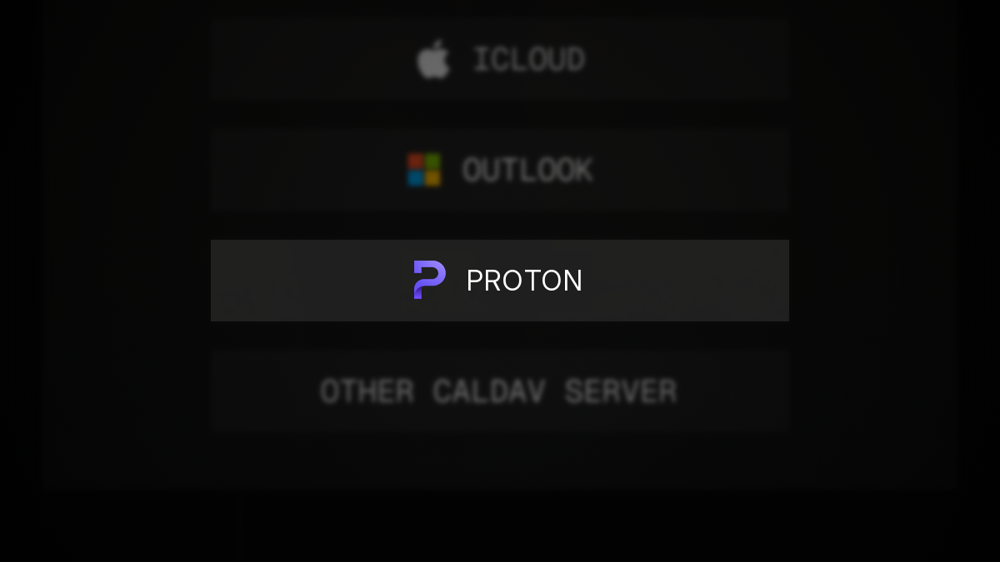

# caldir-provider-proton

A [caldir](https://caldir.org) provider for [Proton Calendar](https://proton.me/calendar)



## renCal

If you use [renCal](https://rencal.org), install the [Proton plugin](https://rencal.org/plugins/t4t5.proton/) instead of following the steps below.

## Install

Install from crates.io:

```bash
cargo install caldir-provider-proton
```

<details>
<summary>Install from source</summary>

```bash
git clone https://github.com/t4t5/caldir-provider-proton.git
cd caldir-provider-proton
cargo install --path .
```

</details>

`caldir-provider-proton` should now be available on `PATH` for caldir to discover it.

The default Cargo install stays GUI-free. To let `caldir connect proton` open Proton's CAPTCHA window when human verification is required, build with the `hv` feature:

```bash
cargo install caldir-provider-proton --features hv
```

On Debian and Ubuntu, building with `hv` requires `libwebkit2gtk-4.1-dev`. Release archives are built with `hv`.

## Connect

```bash
caldir connect proton
```

Enter the email and password for your Proton account to authenticate. If Proton asks for a CAPTCHA and the provider was built with `hv`, a small verification window opens and the same connect command continues after it is solved.

On a headless machine, or without the helper, sign in at [account.proton.me](https://account.proton.me) from the same network and retry the connect command.

## How it works

The provider talks directly to Proton's servers, like Proton's web app, and keeps end-to-end encryption intact:

- **Your password never leaves your machine.** Sign-in uses Proton's SRP protocol, so only a cryptographic proof is sent.
- **Encryption happens locally**, using Proton's open-source [Rust crypto libraries](https://github.com/ProtonMail/proton-crypto-rs). As in Proton's own apps, titles, descriptions and locations are encrypted; times, recurrence and reminders are signed only.
- **No third parties.** Only Proton's servers are contacted. No telemetry or analytics.
- **No password stored after sign-in.** Only a session token and a key secret derived from your password are kept, in owner-only files under `~/.config/caldir/providers/proton/`.

Keep in mind:

- caldir stores events as plain `.ics` files, so use full-disk encryption.
- The key secret can unlock your Proton keys, so treat that folder like a password. To disconnect, revoke the session in Proton's security settings and delete it.
- This project isn't affiliated with Proton and uses its unofficial web API, which may change without notice.

## License

MIT
